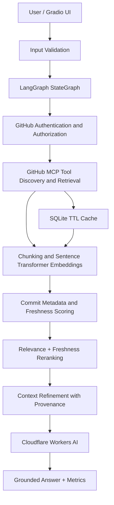
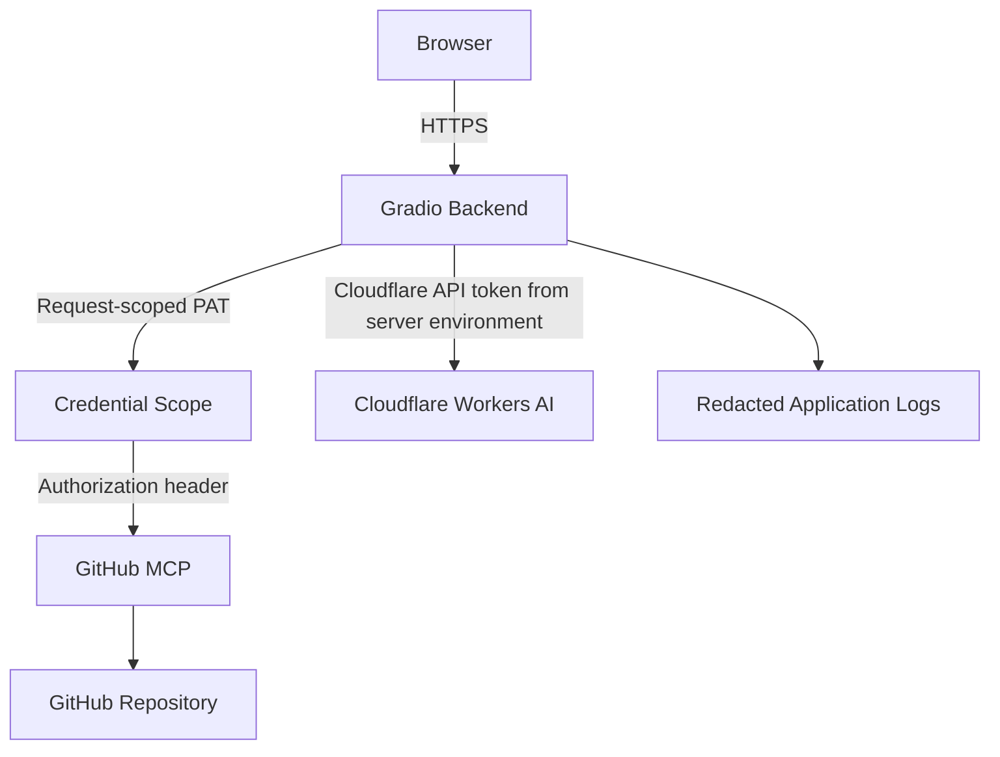

# FreshTrust-MCP Architecture

## Security data flow

The backend must read/use the GitHub token, so this is not end-to-end encryption. TLS protects network transport; the PAT is not persisted by the application.
